# 🎉 Eventora – Comprehensive Multilingual Event Management and Analytics Platform

**Manage Events. Measure Success.**

Eventora is a MERN stack-based web application designed to simplify event management through event creation, participant registration, online ticket booking, secure payment processing, QR code ticket generation, multilingual support, and real-time analytics.

The platform provides separate dashboards for Participants, Organizers, and Administrators to ensure efficient event management.

## 🚀 Key Features

- **User Authentication:** Secure registration and login using JWT and bcrypt.
- **Event Management:** Organizers can create, update, and manage events.
- **Online Booking:** Participants can browse events and book tickets.
- **Secure Payments:** Razorpay integration for payment processing.
- **QR Code Tickets:** Automatic QR code generation for event tickets.
- **Email Notifications:** Automated email notifications using Nodemailer.
- **Multilingual Support:** Supports five languages.
- **Analytics Dashboard:** Track users, events, bookings, and revenue.
- **Role-Based Access:** Separate functionalities for Participants, Organizers, and Administrators.

## 👥 User Roles

| Role | Functionalities |
|---|---|
| Participant | Browse events, book tickets, make payments, access tickets |
| Organizer | Create events, manage bookings, monitor event performance |
| Administrator | Manage users, monitor events, view platform analytics |

## 🌐 Supported Languages

Eventora supports:

- English
- Kannada
- Hindi
- Telugu
- Tamil

## 🛠️ Technologies Used

### Frontend
- React.js
- React Router
- Axios
- CSS / Tailwind CSS
- i18next

### Backend
- Node.js
- Express.js

### Database
- MongoDB
- Mongoose

### Authentication & Security
- JSON Web Token (JWT)
- bcrypt

### Integrations & Tools
- Razorpay (Test Mode)
- Nodemailer
- QR Code Generation
- Postman
- Vite

## 📂 Project Structure

```text
Eventora/
│
├── client/                 # React Frontend
│
├── server/                 # Node.js & Express Backend
│
├── .gitignore
├── package.json
├── package-lock.json
└── README.md
```

## ⚙️ Installation and Setup

### 1. Clone the Repository

```bash
git clone https://github.com/suchitraKM-7/Eventora-A-Comprehensive-Multilingual-Event-Management-and-Analytics-Platform.git
```

### 2. Navigate to the Project

```bash
cd Eventora-A-Comprehensive-Multilingual-Event-Management-and-Analytics-Platform
```

### 3. Install Backend Dependencies

```bash
cd server
npm install
```

### 4. Install Frontend Dependencies

Open another terminal:

```bash
cd client
npm install
```

### 5. Configure Environment Variables

Create a `.env` file inside the server folder.

Configure the required environment variables according to your backend configuration, including:

- MongoDB connection string
- JWT secret
- Razorpay test credentials
- Email configuration

**Note:** Never upload your `.env` file or private API credentials to GitHub.

### 6. Run the Application

Start the backend:

```bash
cd server
npm start
```

Start the frontend in another terminal:

```bash
cd client
npm run dev
```

Open the local URL displayed by Vite in your browser.

## 📊 Analytics Dashboard

The platform provides analytics to monitor:

- Total registered users
- Active users
- Total events
- Total bookings
- Revenue generated
- Event-wise revenue
- Organizer-wise revenue
## 📸 Project Screenshots

### Eventora Landing Page


### Participant Dashboard

#### Dashboard Overview


#### Available Events
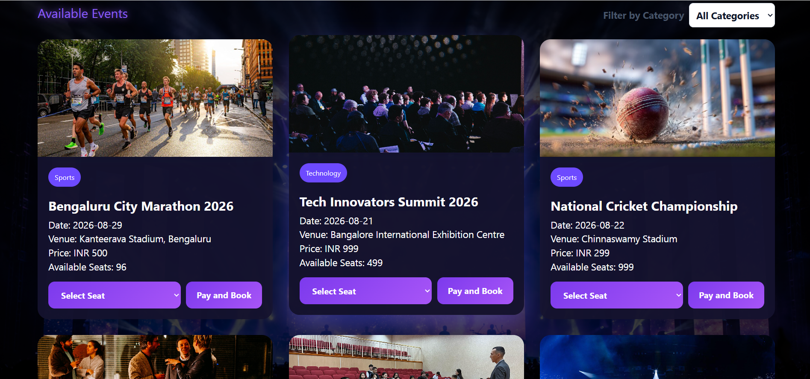
## Participant Dashboard

### Dashboard Overview


### Available Events


## Organizer Dashboard

### Dashboard Overview
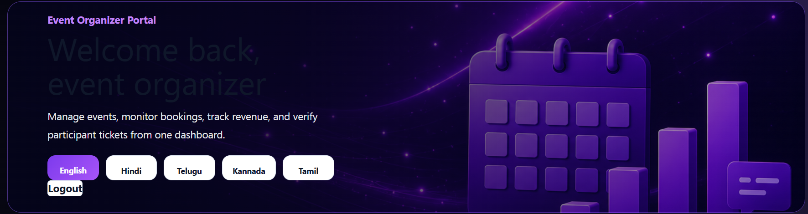

### Quick Actions and Statistics
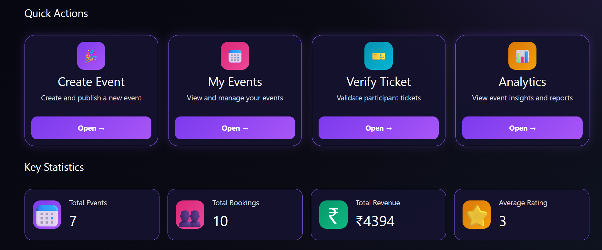

### Recent Events and Analytics
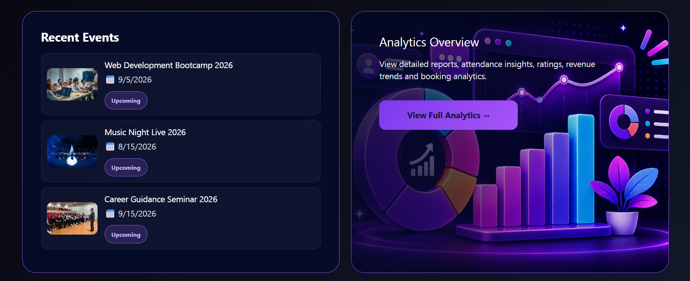

## Admin Dashboard

### Dashboard Overview
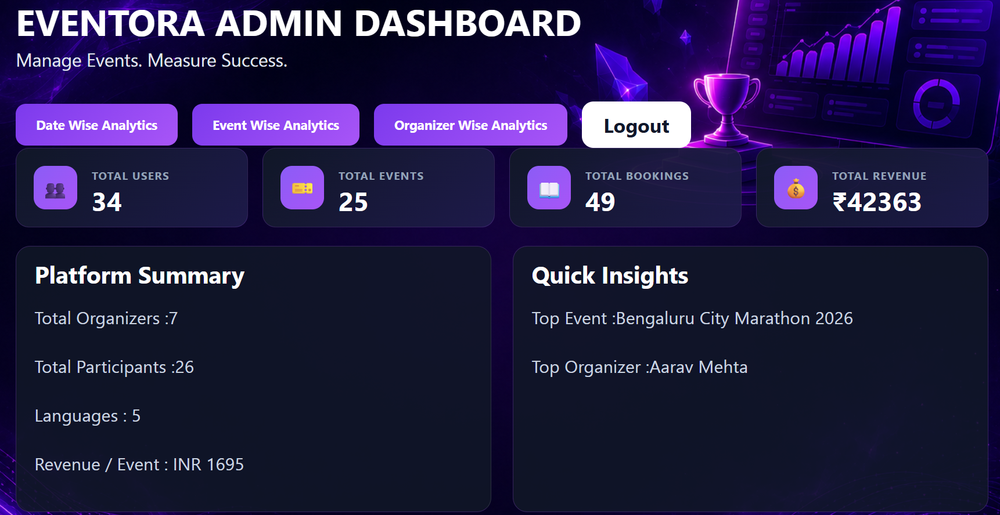

### Date-wise Analytics
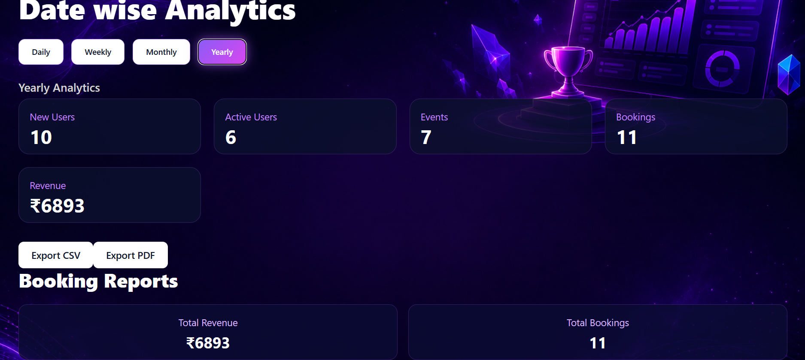

### Event-wise Analytics
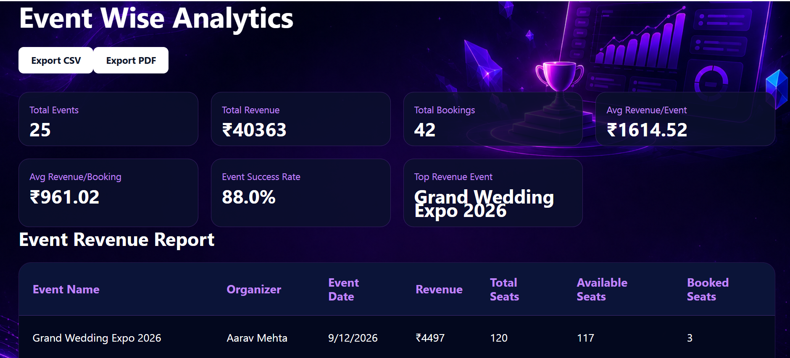

### Organizer-wise Analytics
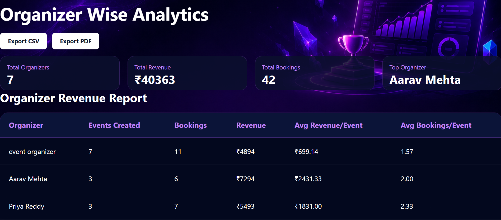

## Other Features

### Create Event
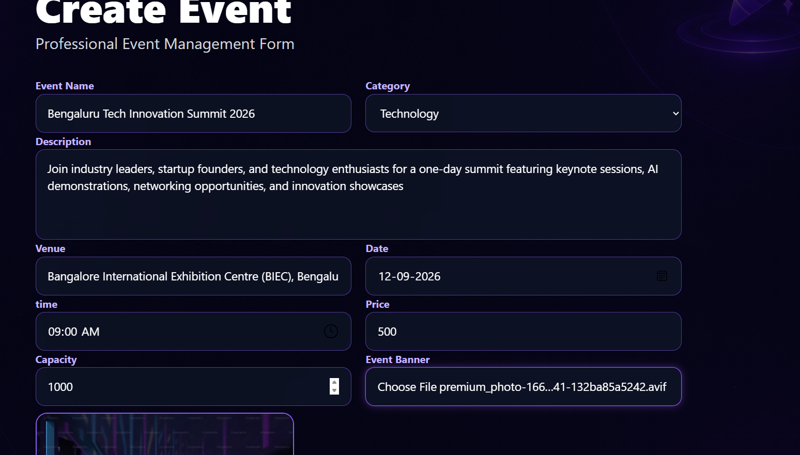

### My Bookings
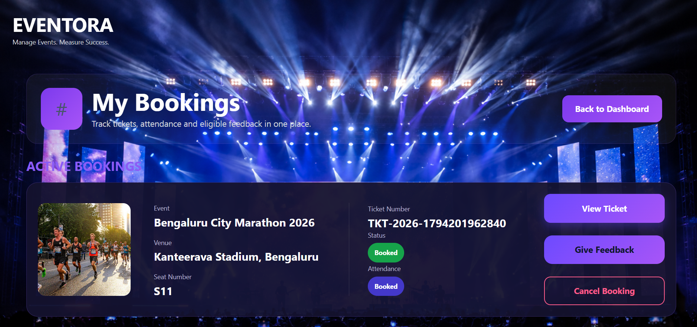

### QR Ticket
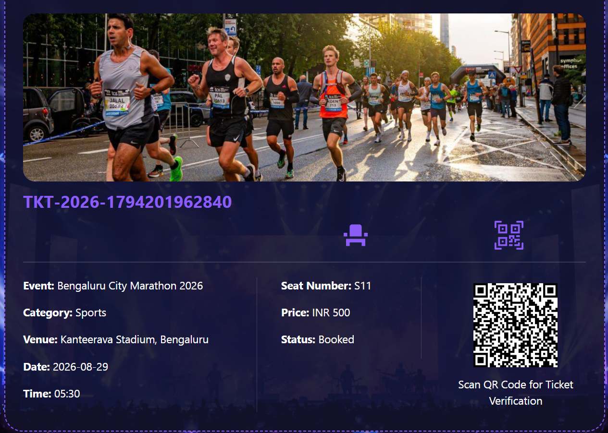

## 🔮 Future Enhancements

- Live event tracking.
- Advanced reporting and analytics.
- Enhanced event recommendation system.
- Cloud-based deployment.
- Improved mobile responsiveness.

## 👩‍💻 Developer

**Suchitra K M**

Master of Computer Applications (MCA)

GitHub: https://github.com/suchitraKM-7

---

⭐ If you find this project interesting, don't forget to star the repository!

**Eventora – Manage Events. Measure Success.**
